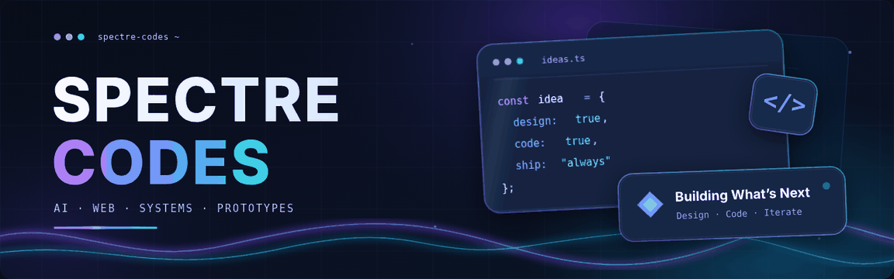

<p align="center">
  
</p>

<p align="center">
  <strong>Computer Science Student · Creative Developer · Hackathon Builder</strong><br>
  Building useful software, thoughtful interfaces, and experiments with AI.
</p>

<p align="center">
  <a href="https://github.com/spectre-codes?tab=repositories"></a>
  <a href="https://github.com/spectre-codes/tastelight-studio"></a>
</p>

---

## ⚡ About Me

```typescript
const spectre = {
  focus: ["Creative Development", "Full-Stack Apps", "AI Workflows"],
  languages: ["C++", "Java", "Python", "TypeScript", "JavaScript"],
  tools: ["Blender", "VS Code", "Git"],
  environment: "Fedora Linux",
  approach: "Design → Build → Test → Improve"
};
```

- 🎓 Studying **Computer Science** and learning by building.
- 🧠 Interested in **AI applications, interactive web experiences, and creative software**.
- 🚀 Exploring new ideas through **hackathons and side projects**.

---

## 🛠️ Tools & Technologies

<p align="center">
  
</p>

---

## ✨ Featured Project

<h3 align="center"><a href="https://github.com/spectre-codes/tastelight-studio">TasteLight Studio</a></h3>

<p align="center"><strong>Cultural intelligence for architectural lighting design</strong></p>

A design workbench exploring how cultural taste signals can shape lighting concepts, visual previews, and side-by-side design decisions.

<p align="center">
  
  
  
</p>

<p align="center">
  <a href="https://github.com/spectre-codes/tastelight-studio"></a>
</p>

---

## 📈 Building in Public

<p align="center">
  <a href="https://github.com/spectre-codes?tab=overview"></a>
</p>

<p align="center">
  
</p>

<p align="center"><i>Building what’s next, one project at a time.</i></p>
