<!-- SPECTRE CODES / GitHub profile -->
<p align="center">
  
</p><p align="center">
  <b>Computer Science Undergraduate · Creative Developer · Hackathon Builder</b><br />
  Building useful software, thoughtful interfaces, and experiments with AI.
</p><p align="center">
  <a href="https://tastelight-studio.vercel.app/"></a>
  <a href="https://github.com/spectre-codes?tab=repositories"></a>

## ⚡ About Me

```typescript
const spectre = {
  role: "Computer Science Student",
  interests: ["Creative Development", "AI", "Full-Stack Apps"],
  languages: ["TypeScript", "JavaScript", "Python", "Java"],
  environment: "Fedora Linux + VS Code",
  philosophy: "Build → Validate → Improve"
};
```

- 🎓 Computer Science student, learning through hands-on projects.
- 🧠 Interested in **AI-assisted software, web development, and automation**.
- 🚀 Exploring ideas through **hackathons and experiments**.

---

## 🛠️ Tools & technologies
  
🛠️ Tools & technologies
<p align="center">
  
</p>✨ Featured project
<h3 align="center"><a href="https://github.com/spectre-codes/tastelight-studio">TasteLight Studio</a></h3>
<p align="center"><b>Cultural intelligence for architectural lighting design</b></p>TasteLight Studio is a design workbench exploring how cultural taste signals can inform lighting concepts. It brings visual previews, design iteration, and side-by-side comparisons into one workflow.
<p align="center">
  
  
  
</p><p align="center">
  <a href="https://tastelight-studio.vercel.app/"></a>
  <a href="https://github.com/spectre-codes/tastelight-studio"></a>
</p>📈 Building in public
<p align="center">
  <a href="https://github.com/spectre-codes?tab=overview"></a>
</p><p align="center"><sub>Contribution activity and pinned repositories are shown on my GitHub profile.</sub></p><p align="center">
  <a href="https://github.com/spectre-codes?tab=repositories"></a>
  <a href="https://github.com/spectre-codes"></a>
</p><p align="center"><i>Build thoughtfully. Keep shipping.</i></p>
